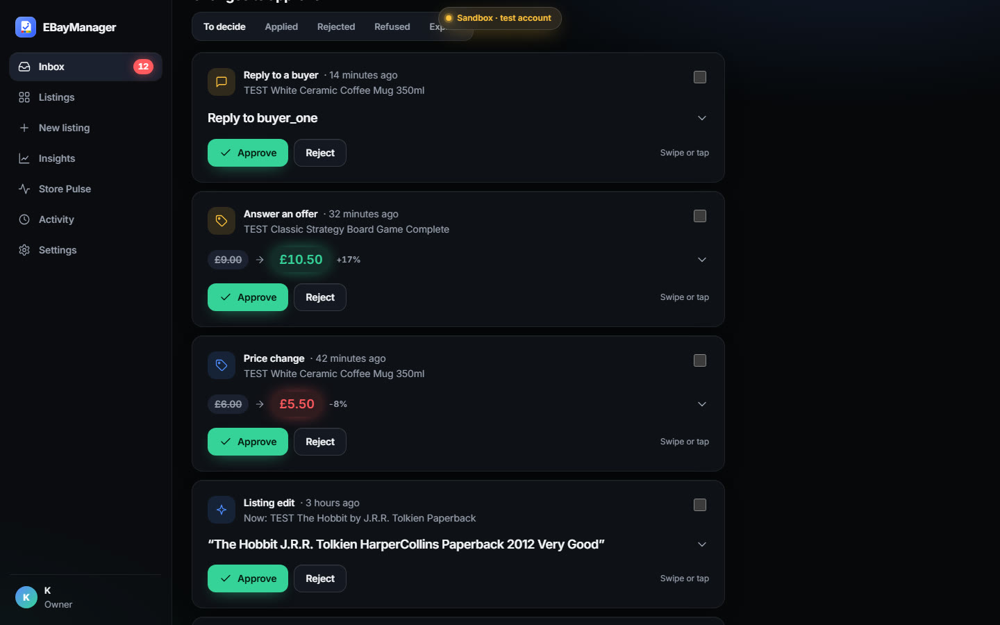

# EBayManager

An approval-first selling assistant for eBay UK. It watches your listings, prices them from the live market,
builds new listings from photos, drafts replies to buyers and suggests offers and promotion. **Nothing changes
on your eBay account until a person approves it**, from a push notification or the app's Inbox.

It runs on your own Azure subscription with your own eBay and Anthropic keys, and serves one installable app
(PWA) for phone and desktop.



## Features

- **Approvals for everything.** Every price, revision, offer, message, promotion and new listing is a proposal
  with a reason. Approve or reject it from a Web Push notification or the Inbox. A History tab keeps every outcome.
- **Market-based pricing.** Each price check searches eBay's live listings for the same item in the same
  condition, adds sold prices from Trawl and CompsAPI when configured, and prices just under realistic competition.
  It never goes below your floor and never moves more than 10% in one step ([pricing engine](docs/pricing-engine.md)).
- **New listings from photos.** A wizard checks your photos, identifies the item, looks up specifications only
  for an exactly identified product (with sources), writes the title and description, prices it and works out
  postage ([add listing](docs/add-listing.md)). Optional self-hosted photo tools remove backgrounds, erase clutter
  and upscale ([photo AI](docs/imageai.md)).
- **A nightly review** at 02:00 UTC: snapshot and sales sync, health flags, a price review, and a "sales ladder"
  that gives a slow listing one push a week (better title and specifics, promotion, an offer to watchers, then price).
- **Buyers and offers.** Every 5 minutes it reads Best Offers, questions and sales; Claude drafts replies in your
  style and you approve each one. Nothing is auto-accepted or auto-declined.
- **Store Pulse and Insights** for sales, traffic, spend and service health, plus Inbox to-dos when an outside
  service fails or eBay refuses a change.
- **Up to three people:** one owner and two managers, each signing in with email and an authenticator code.

## How it stays safe

| Safeguard | Where |
| --- | --- |
| One write gate. Only `ebayWrite()` may call eBay write endpoints, and only for an approved proposal with `WRITE_MODE=approval` and the kill switch off. Every write is audited | `src/ebay/write.ts` |
| An allowlist of every eBay call the app may make; anything else is refused | `src/ebay/allowlist.ts` |
| Prices, offers, messages, promotion, new and ended listings and policies can never auto-apply, whatever the settings say | `src/rules.ts` |
| Source-scanning tests fail if any other code reaches an eBay write endpoint | `test/safety.test.ts` |
| The site is hidden: a blank 404 for anyone not signed in, with the sign-in page at a secret address | `src/signin.ts` |
| Sandbox and production are separate Azure resource groups and databases; production scripts refuse to run without `EBAY_CONFIRM_PRODUCTION=yes` | `infra/`, `scripts/` |

The full model is in [security.md](docs/security.md) and [approvals.md](docs/approvals.md).

## Architecture

TypeScript on Azure Functions (Flex Consumption), Cosmos DB for NoSQL (free tier), Blob Storage, Key Vault and a
Storage Queue, deployed with Bicep. eBay's Trading API (XML) and REST APIs; Claude through the Anthropic API
(Sonnet for listings and photos, Haiku for triage and drafts). The app is Vite, Preact, Tailwind and Framer
Motion, served by the same Function App. See [architecture.md](docs/architecture.md).

## Requirements

- **An eBay UK seller account.** The marketplace is fixed to eBay UK (`EBAY_GB`, prices in GBP), and postage uses
  UK services (Parcel2Go, eBay Simple Delivery). The pricing engine assumes a private seller (no final value fees).
- **An eBay developer account** ([developer.ebay.com](https://developer.ebay.com)) with a Sandbox keyset, and a
  Production keyset when you go live.
- **An Anthropic API key** ([console.anthropic.com](https://console.anthropic.com)). Typical spend is a few dollars
  a month, with a hard daily cap of $1.
- **An Azure subscription** where you are Owner. Cosmos DB's free tier allows one account per subscription; if
  yours already has one, the deployment fails until you remove it or use another subscription.
- **Node.js 22**, the **Azure CLI** (`az`) with Bicep, and Git. Commands below are PowerShell; any shell works.
- **Optional:** Trawl and CompsAPI keys (sold prices), Parcel2Go API credentials (postage quotes), and an
  authenticator app (Google or Microsoft Authenticator) on each person's phone, which is required to sign in.

## Setup

Set up **Sandbox** first. It uses eBay's test environment and test users, so you can try everything with no risk
to your real account. Production is the same steps with `production` and `.prod.vars`.

### 1. Clone and install

```powershell
git clone https://github.com/<you>/EBayManager; cd EBayManager
npm install
npm run typecheck; npm test
```

### 2. Create the Azure resources

```powershell
az login
node scripts/azure-infra.mjs sandbox
```

This creates `rg-ebay-shared` (the Cosmos DB account) and `rg-ebay-sandbox` (the Function App, storage, Key
Vault and logs), and prints the app's address, `https://ebay-autopilot-sandbox-<suffix>.azurewebsites.net`. The
default region is France Central; set `$env:AZURE_LOCATION` first to choose another region that supports Flex
Consumption. If the budget alert fails to deploy (some subscription offers don't support budgets), add
`param createBudget = false` to `infra/sandbox.bicepparam` and run it again.

### 3. Configure your eBay application

In the eBay developer portal, for the Sandbox keyset:

1. **Application Keys:** copy the App ID, Cert ID and Dev ID.
2. **User Tokens → Get a Token from eBay via Your Application:** add an eBay Redirect URL (RuName). Set its
   *auth accepted URL* to `https://<your app>/oauth/callback` and its *privacy policy URL* to
   `https://<your app>/privacy.html`. Copy the RuName.
3. For the **Production** keyset only, eBay asks for a *marketplace account deletion* endpoint: use
   `https://<your app>/ebay/account-deletion` with the `EBAY_DELETION_TOKEN` from the next step. The app answers
   eBay's challenge and deletes a buyer's stored data when eBay says so.

### 4. Add your secrets

```powershell
Copy-Item .dev.vars.example .dev.vars    # then fill in the eBay keys and ANTHROPIC_API_KEY
node scripts/make-keys.mjs               # generates the signing, push and deletion keys
node scripts/azure-secrets.mjs sandbox   # uploads every value to Key Vault (names are printed, values never)
```

Every variable is explained in [.dev.vars.example](.dev.vars.example). Leave optional services empty to switch
them off. `.dev.vars` and `.prod.vars` are gitignored: never commit them.

### 5. Set yourself up as the owner

```powershell
node scripts/people.mjs sandbox add --email you@example.com --name "Your name" --role owner
```

A QR code opens. Scan it with Google or Microsoft Authenticator, then press Enter (the image is deleted). The
script uploads the people list, restarts the app and prints your **hidden sign-in address**
(`https://<your app>/s/<secret>`). Keep it private; everyone else sees a blank page.

### 6. Deploy and connect eBay

```powershell
node scripts/azure-deploy.mjs sandbox        # typecheck, tests, build, upload
node scripts/check-production.mjs sandbox    # read-only checks from outside
```

1. Open your sign-in address, sign in with your email and the 6-digit code.
2. On Android, Chrome menu → **Install app**; then **Settings → Notifications → Turn on**.
3. **Settings → eBay connection → Connect your eBay account**, and sign in to eBay (on Sandbox, as your Sandbox
   test seller).
4. Set floors for your items under **Listings → Facts and floor**.

### 7. Going live on your real account

1. Repeat steps 2 to 6 with `production` and `.prod.vars` (copied from the example, with your **Production** eBay
   keyset). Every production command needs `$env:EBAY_CONFIRM_PRODUCTION='yes'` in the same window.
2. `infra/production.bicepparam` ships with `writeMode = 'approval'`. To connect your account read-only first,
   set it to `'off'`, run `azure-infra.mjs production`, and let one nightly run complete.
3. Work through the [go-live tests](docs/go-live-tests.md), then set `writeMode = 'approval'` and run the
   infrastructure update again. Reconnect eBay in Settings so it grants the seller permissions writes need.

## People: one owner and up to two managers

People are managed **only** from your computer with `scripts/people.mjs`; the app has no way to add or change
anyone. Each command updates the vars file, uploads it to Key Vault and restarts the app.

| You want to | Run |
| --- | --- |
| See who's set up | `node scripts/people.mjs <env> list` |
| Show the hidden sign-in address | `node scripts/people.mjs <env> link` |
| Add a manager | `node scripts/people.mjs <env> add --email sam@example.com --name Sam --role manager` |
| Give someone a new phone or authenticator | `node scripts/people.mjs <env> new-code --email sam@example.com` |
| Fix a mistyped email (same authenticator) | `node scripts/people.mjs <env> change-email --email old@example.co --to new@example.com` |
| Remove a manager (ends their sessions) | `node scripts/people.mjs <env> remove --email sam@example.com` |
| A fresh sign-in address (if the old one leaked) | `node scripts/people.mjs <env> new-link` |
| The sign-in page only loads some of the time | `node scripts/people.mjs <env> refresh` |

**Adding a manager:** run `add` with the manager beside you or on a video call, so the QR code only ever appears on
your screen. They scan it, then you send them the sign-in address privately. On their phone they sign in, install
the app and turn on notifications.

| | Owner | Manager |
| --- | :---: | :---: |
| See everything, approve or reject changes, edit reply drafts, create listings | ✓ | ✓ |
| Pause all changes | ✓ | ✓ |
| Resume changes, auto-apply switches, connect eBay | ✓ | |
| Set prices directly, answer questions about items, set listing-style rules | ✓ | |
| Sign other people out | ✓ | |

If a manager loses their phone, sign them out from **Settings → People → Sign out everywhere**, then run
`new-code` when they have a new one.

## Operating it

| Task | Command |
| --- | --- |
| Health check (read-only) | `node scripts/check-production.mjs [sandbox]` |
| Read logs | `node scripts/logs.mjs <env> [--since 24h] [--errors] [--item <id>]` |
| Query the database (read-only) | `node scripts/prod-query.mjs <env> <container> "SELECT ..."` |
| Deploy code | `node scripts/azure-deploy.mjs <env>` |
| Update infrastructure | `node scripts/azure-infra.mjs <env>` |
| Upload changed secrets | `node scripts/azure-secrets.mjs <env>`, then `people.mjs <env> refresh` |

**Deploying from GitHub** (no computer needed): `.github/workflows/deploy.yml` deploys Sandbox at once and
production after a required reviewer approves, only from `main`. One-time set-up per environment, signed in to
Azure (Azure Cloud Shell works):

```sh
node scripts/azure-github-oidc.mjs sandbox
EBAY_CONFIRM_PRODUCTION=yes node scripts/azure-github-oidc.mjs production
```

Each run prints five values to add as variables of a GitHub environment of the same name. On `production`, add
yourself as a required reviewer and allow only `main`. No password is stored: GitHub signs in with OpenID Connect
as an identity that can only publish to that one Function App.

**Uptime:** set the repository variable `UPTIME_URL` to your production address and `.github/workflows/uptime.yml`
checks it hourly; GitHub emails you when it fails.

**Renewals:** the eBay connection lasts about 18 months; Settings then shows *Connect your eBay account* again.
Sessions last 30 days on a device where *Stay signed in* was ticked.

## Costs

| Service | Typical monthly cost |
| --- | --- |
| Claude (Anthropic API) | About $2 to $8. Nightly checks cost cents; each new listing about $0.30 to $0.80. Hard cap of $1 a day, shown under Settings → Usage and APIs. Set `claudeDailyBudgetUsd = '0'` in a `.bicepparam` file to switch Claude off |
| Azure Functions, Cosmos DB, storage, Key Vault | £0 to £3, mostly inside Azure's free allowances. Log volume is capped daily; a budget alert emails at 50% and 100% of $5 |
| Photo AI container (optional) | £0 when idle (scales to zero) |
| Trawl, CompsAPI, Parcel2Go (optional) | Their own plans; the app enforces monthly caps |

## Optional integrations

- **Photo AI** ([imageai.md](docs/imageai.md)): background removal, spot removal and upscaling in your own
  container on Azure Container Apps.
- **Sold-price data** ([sold-price-data.md](docs/sold-price-data.md)): Trawl and CompsAPI, pooled and cached.
- **Microsoft Power Platform** ([power-platform.md](docs/power-platform.md), [powerplatform/](powerplatform/README.md)):
  a read-only API for Power BI and Power Automate, and a draft-only intake. Both are off until you set their keys.
- **MCP** (`/mcp`, Sandbox only): the same tools from Claude Desktop or Claude Code.

## Development

```sh
npm run typecheck && npm test   # tsc and vitest
MOCK=1 npm run dev:web          # the app on sample data, no accounts needed
npm run test:cosmos             # store tests against the Cosmos DB emulator, if installed
node scripts/sandbox-listing-check.mjs   # an end-to-end new-listing check against a deployed Sandbox
```

| Path | Contents |
| --- | --- |
| `src/index.ts` | Routes and the scheduled runs |
| `src/ebay/` | eBay OAuth, the Trading and REST clients, the allowlist and the write gate |
| `src/proposals.ts`, `src/history.ts` | Proposals, signed approval links, and their outcomes |
| `src/pricing/` | The pricing engine (model, identification, learning, bundles) |
| `src/nightly.ts`, `src/inbox.ts`, `src/ladder.ts` | The nightly review, the 5-minute poll and the sales ladder |
| `src/drafts.ts`, `src/newlisting.ts`, `src/postage.ts` | New listings: drafts, text, price and postage |
| `src/auth/`, `src/signin.ts` | People, authenticator codes, sessions and the hidden sign-in page |
| `src/store/` | The data layer: Cosmos DB and an in-memory implementation behind one interface |
| `src/platform/azure/` | The Azure Functions adapter |
| `web/` | The PWA (Preact, Tailwind, Framer Motion) |
| `infra/` | Bicep templates and per-environment parameters |
| `imageai/` | The photo AI container (FastAPI, ONNX Runtime) |
| `scripts/` | Infrastructure, secrets, people, deploy, checks and diagnostics |
| `test/` | Vitest, including the write-gate and safety tests |
| `docs/` | Design documents (below) |

**Design documents:** [architecture](docs/architecture.md) · [security](docs/security.md) ·
[approvals](docs/approvals.md) · [safety and environments](docs/safety-and-environments.md) ·
[pricing engine](docs/pricing-engine.md) · [pricing and promotion](docs/pricing-and-promotion.md) ·
[sold-price data](docs/sold-price-data.md) · [listing assistant](docs/listing-assistant.md) ·
[add listing](docs/add-listing.md) · [app and dashboard](docs/app-and-dashboard.md) ·
[design system](docs/design-system.md) · [photo AI](docs/imageai.md) · [Parcel2Go](docs/parcel2go-api.md) ·
[Power Platform](docs/power-platform.md) · [go-live tests](docs/go-live-tests.md)

A portfolio showcase on sample data is in [docs/showcase/](docs/showcase/).
